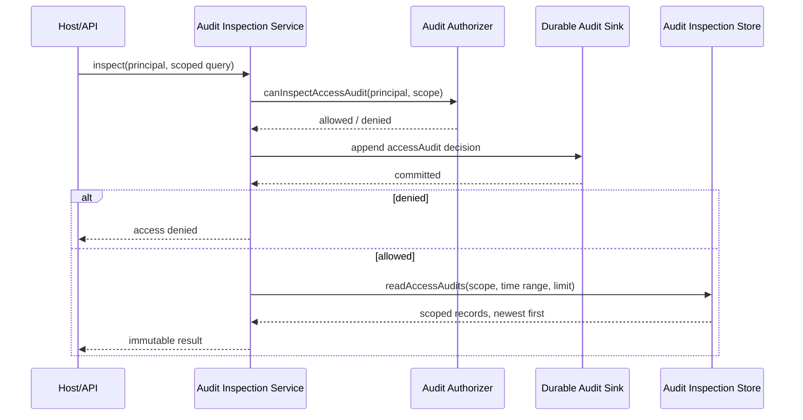

# Authorized Plugin Revocation Access-Audit Inspection

## Purpose

The durable access-audit adapters introduced by the revocation persistence
packages provide append and scope-filtered read operations. This document
defines the application boundary required before a host exposes those reads.

The runtime service is
`PluginRevocationAccessAuditInspectionService`. It deliberately uses a
separate `PluginRevocationAccessAuditAuthorizer` rather than reusing the
ordinary operations-inspection permission. Permission to inspect plugin
revocation state does not implicitly grant permission to inspect the security
audit trail.

## Request sequence



The audit append must complete before any read. If authorization denies the
request, the denied attempt is still appended before the service throws. If
the append fails, the read is not attempted. If the inspection adapter is not
configured, the service fails closed after recording the allowed attempt.

## Contract and constraints

- The principal is host-authenticated. Alhambra does not parse tokens or bind
  this API to a specific identity provider.
- The dedicated authorizer receives the exact requested scope and makes the
  host's audit-log permission decision.
- Queries require a non-empty scope, a limit from 1 through 200, and a valid
  half-open time range (`fromInclusive`, `toExclusive`).
- The storage adapter must enforce scope and time predicates in the database,
  return newest-first order, and apply the limit in storage.
- Results are immutable and contain only the requested scope.
- Query fingerprints are SHA-256 hashes of canonical query fields. Raw query
  values and cursor material are not stored in the access-audit event.
- Every attempt is appended with resource `accessAudit`, including denied
  attempts. The service does not call itself to inspect its own audit record;
  the persistence sink must remain a low-level append operation.
- The same durable adapter may implement both append and inspection
  interfaces. A host may instead use a separate audit database with
  independent access, backup, and retention controls.

## Host integration

A host should wire the SQLite or PostgreSQL access-audit adapter into both
ports, then provide an audit-specific authorizer:

```dart
final auditStore = SqlitePluginRevocationAccessAuditStore(database);
auditStore.migrate();

final auditInspection = PluginRevocationAccessAuditInspectionService(
  authorizer: hostAuditAuthorizer,
  accessAuditStore: auditStore,
  inspectionStore: auditStore,
);

// In an authenticated host handler:
final result = await auditInspection.inspect(
  principal: PluginRevocationOperationsPrincipal(actorId: authenticatedActorId),
  query: PluginRevocationAccessAuditQuery(
    scopeId: authorizedScopeId,
    limit: 100,
  ),
);
```

The host must not accept `actorId` or `scopeId` as trusted identity claims
from an untrusted request body. Derive the principal from the authenticated
session and authorize the requested scope against host policy.

## Operational integrity

The adapters provide transactional append and bounded, scope-filtered reads;
they do not make the database intrinsically immutable or tamper-proof.
Production deployments should:

1. Use a dedicated database role for the application writer.
2. Deny UPDATE and DELETE to the application role (and use a separate
   controlled maintenance role for retention operations).
3. Restrict audit-log read access to the dedicated authorization path.
4. Define backup, retention, legal-hold, and archival policies.
5. Monitor append failures and fail closed when the audit sink is unavailable.
6. Consider external immutable backups or periodic signed checkpoints when
   tamper evidence is required.

A hash chain or external anchor can strengthen tamper evidence in a later
adapter revision, but a local hash chain alone cannot prevent a privileged
database operator from rewriting the entire chain. Do not describe these
adapters as cryptographically immutable.

## Consistency and pagination

The current inspection contract is bounded by limit and time range; it does
not yet expose continuation cursors or a strict database snapshot. Newer
records may appear between requests. For compliance exports requiring a
stable point-in-time view, create an explicit export job using a database
snapshot or materialized export boundary rather than repeatedly querying this
operational inspection endpoint.
