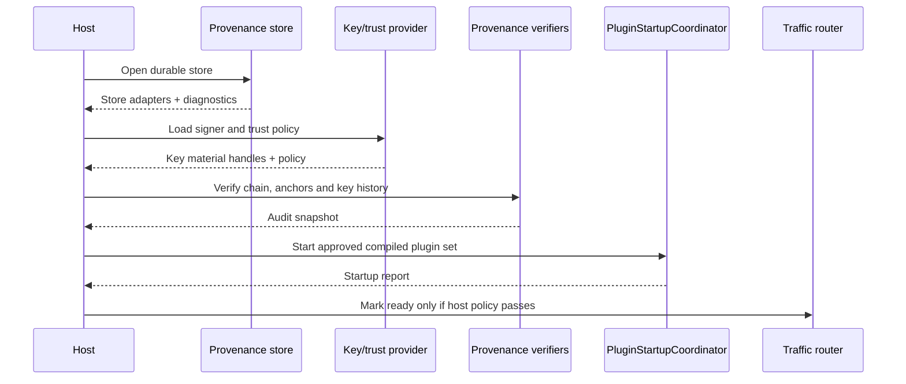
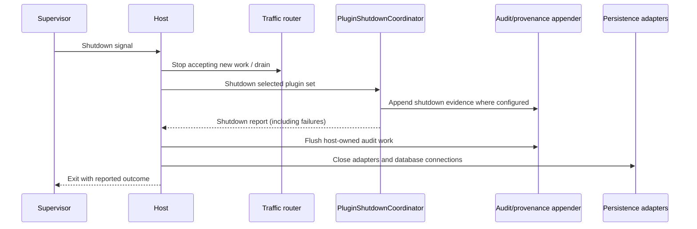
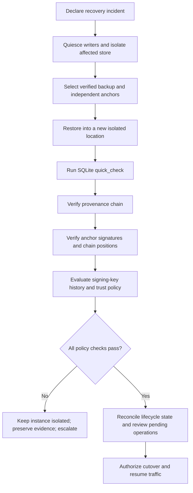

# Recovery Provenance Host Operations

This runbook describes how an application host should operate Alhambra's
recovery-provenance contracts and the optional SQLite adapter. It is an
integration guide, not a scheduler, process supervisor, health endpoint,
backup service, or automatic recovery engine.

The host is the composition root and owns deployment policy, resource lifetime,
readiness decisions, backup destinations, retention, authorization, alert
routing, and restore approval.

## 1. Runtime ownership

Keep the following boundaries explicit:

| Concern | Owner |
|---|---|
| Append-only event, anchor, and signing-key contracts | `alhambra_plugin_runtime` |
| SQLite transactions, schema, diagnostics, WAL checkpoint, snapshot API | `alhambra_plugin_provenance_sqlite` |
| Plugin activation/deactivation order | `PluginStartupCoordinator` / `PluginShutdownCoordinator` |
| Signing, key custody, trust policy, and independent anchor destination | Host or external security service |
| Backup scheduling, encryption, off-host copy, retention, restore approval | Host / platform operations |
| Liveness/readiness endpoints and alert delivery | Host / deployment platform |

Do not put deployment-specific policy or a scheduler in the neutral runtime.
Do not treat the SQLite adapter as a multi-host database. A deployment with
multiple application replicas or independent writers needs a server database
adapter whose transactions and uniqueness constraints are validated across
workers. Do not share a live SQLite file through object storage or an
unreliable network filesystem.

## 2. Startup sequence

Construct persistence before any service that appends or verifies provenance.
Validate the store before accepting traffic. Plugin activation remains an
explicit host decision and should happen only after required infrastructure
and policy dependencies are available.

Recommended host sequence:

1. Load configuration and secrets from the host's secret manager.
2. Open the durable provenance adapter and any independent anchor/key-history
   stores. Fail closed if required stores cannot be opened.
3. Inspect adapter diagnostics. For SQLite, inspect schema version, journal
   mode, synchronous mode, busy timeout, row counts, and `quick_check`.
   Treat the counts as advisory during concurrent writes; diagnostics are not
   a transactionally consistent snapshot.
4. Load signing and verification implementations and host trust policy.
   Never place private key bytes in Alhambra diagnostics or event records.
5. Run the provenance-chain verifier and anchor verifier. Evaluate signing-key
   history under the host's trust policy. A valid but stale anchor indicates
   an unanchored tail; it is not by itself proof of chain corruption.
6. Decide whether the current audit state satisfies the deployment's
   acceptance policy. Record a sanitized operational incident when it does not.
7. Start the approved compiled plugin set with
   `PluginStartupCoordinator`. Do not activate arbitrary downloaded Dart code.
8. Publish readiness only after required plugins and dependencies have
   completed startup and the host's own readiness policy passes.

A failed provenance check should not be silently repaired during startup.
Keep the host unready or enter an explicitly configured degraded mode, preserve
the evidence, and require the appropriate operator or policy decision.

## 3. Liveness, readiness, and operational health

These signals answer different questions and should not be collapsed into one
boolean.

| Signal | Question | Typical inputs |
|---|---|---|
| Liveness | Is this process making progress and able to be supervised? | Event loop/process health; no expensive full-chain scan |
| Readiness | Should this instance receive new work? | Required stores open; startup complete; required plugins active; policy-critical checks pass |
| Provenance integrity | Is the evidence chain and its external checkpoint state acceptable? | Full chain verifier, anchor verifier, signing-key trust assessment |
| Storage health | Can the adapter read/write and does its storage pass diagnostics? | Adapter open state, bounded write probe if safe, SQLite diagnostics |
| Backup health | Is recoverability within the configured recovery-point objective? | Last successful backup, age, off-host copy confirmation, restore-test age |

The runtime's in-memory plugin health registry is useful for local state
projection; it is not a substitute for process health, durable storage health,
or an external monitoring system.

Suggested host-owned metrics (names are illustrative, not built-in Alhambra
metrics):

- `alhambra_provenance_last_event_sequence`
- `alhambra_provenance_last_anchor_sequence`
- `alhambra_provenance_unanchored_event_count`
- `alhambra_provenance_verification_status`
- `alhambra_provenance_store_append_failures_total`
- `alhambra_provenance_backup_last_success_timestamp_seconds`
- `alhambra_provenance_backup_age_seconds`
- `alhambra_provenance_restore_test_age_seconds`

Do not expose chain contents, event payloads, signer secrets, tenant identifiers,
or raw exception text as metric labels. Use bounded labels and sanitized error
codes. Authorization and tenant scoping belong at the host's API boundary.

## 4. Graceful shutdown

Stop accepting new work before shutting down plugins. Use the plugin shutdown
coordinator to deactivate the selected plugin set in reverse dependency order.
Only after plugin callbacks have completed should the host close the stores and
other resources those callbacks may use.

Recommended order:

1. Mark the instance unready and stop accepting new requests/jobs.
2. Drain in-flight host work within the platform's termination grace period.
3. Invoke `PluginShutdownCoordinator` with the exact discovered plugin set
   owned by this host. Its report distinguishes attempted, deactivated,
   untouched, and failed plugins.
4. Continue host cleanup even when one plugin shutdown fails; preserve the
   failure report and any in-flight lifecycle checkpoint for recovery review.
5. Flush host-owned provenance/audit work that is safe to flush after plugin
   deactivation.
6. Close SQLite persistence and other stores only after no callback or
   background worker can use them.
7. Exit with a status that allows the supervisor to distinguish clean shutdown
   from partial failure.

Do not close a database from an independent timer while plugin callbacks may
still be running. Do not interpret a timeout as cancellation of Dart work:
the host must coordinate cancellation and resource ownership explicitly.
The shutdown coordinator attempts remaining plugins after an individual
failure, but it does not provide a global process termination deadline.

## 5. Backup scheduling and retention

The SQLite adapter's `backupTo(destinationPath)` uses SQLite `VACUUM INTO`
to create a consistent standalone snapshot. The destination must not already
exist. This is a snapshot primitive, not a backup-management system.

A production backup job should:

1. Obtain a host-level single-flight lease so two schedulers do not race over
   the same backup destination or retention set.
2. Create a unique destination in a protected directory with restrictive
   permissions and sufficient free space.
3. Call `backupTo` and verify that the resulting file exists and is readable.
4. Run `quick_check` on the snapshot and run provenance/anchor verification
   against the restored or copied snapshot as part of a controlled validation
   path.
5. Encrypt the snapshot before it leaves the trusted storage boundary; keep
   encryption keys separate from the backup object.
6. Copy it to an independently administered off-host destination.
7. Record a sanitized backup manifest: snapshot identifier, creation time,
   source chain identity, event sequence/head digest, schema version, size,
   checksum, encryption key reference, and off-host confirmation.
8. Apply retention only to completed, verified backups according to explicit
   policy. Never prune the live append-only provenance chain as a side effect
   of backup retention.

Anchor publication should be independently scheduled or event-triggered by
the host. Keep the signing key and anchor destination under separate access
controls from the provenance writer where practical.

Choose backup and anchor intervals from the recovery-point objective (RPO),
event volume, and restore cost. For example, if the maximum acceptable
unanchored interval is 15 minutes, the host must publish and independently
confirm anchors at least that frequently under normal operation, while
monitoring delayed or failed publication. A schedule alone is not proof that
an anchor was successfully stored.

A WAL checkpoint is not a backup. Use `checkpointWal()` only for explicit
host-managed WAL maintenance; it does not replace `backupTo`, off-host copy,
or restore testing.

## 6. Restore and disaster recovery

Restore is a controlled operation, not an automatic response to a failed
integrity check.

Restore procedure:

1. Declare the incident, stop all writers, and preserve the original database
   and relevant logs as evidence.
2. Select a backup whose manifest, checksum, encryption metadata, and
   independent off-host confirmation are valid.
3. Restore into a new isolated path. Do not overwrite the original database
   during initial validation.
4. Run SQLite `quick_check` on the restored database.
5. Run `PluginRecoveryProvenanceVerifier` over the restored event chain.
6. Run `PluginRecoveryProvenanceAnchorVerifier` using independently retained
   anchors. Check that the restored head is not behind a trusted external
   checkpoint. A backup that predates the latest anchor is stale and should
   not be silently accepted.
7. Assess event signatures against the historical signing-key records and
   current host trust policy. The cryptographic verifier does not decide
   whether a key is trusted or revoked under deployment policy.
8. Reconcile plugin lifecycle checkpoints and recovery journals. Planning is
   read-only; any recovery execution requires an explicit host decision and
   appropriate approval.
9. Document the recovery point, missing tail (if any), verification results,
   operator approvals, and cutover decision.
10. Cut over only after policy checks pass. Retain the pre-restore evidence
    according to incident and legal-retention policy.

If no independently retained anchor exists, the host cannot claim that the
restored chain has been checked against an independent checkpoint. Report
that limitation explicitly.

## 7. Alerting and incident handling

At minimum, route alerts for:

- provenance append failures or repeated SQLite busy/locked errors;
- invalid event digest/predecessor, invalid anchor signature, missing anchor
  predecessor, or trusted anchor rollback;
- anchor publication lag beyond the configured maximum unanchored interval;
- signing-key state that violates host trust policy;
- database diagnostics failure or unexpected schema version;
- backup age beyond RPO, off-host copy failure, or backup verification failure;
- restore drill overdue or failed;
- plugin startup/shutdown failure that leaves required functionality degraded.

Classify severity using host policy. A stale but valid anchor is generally a
freshness warning; a cryptographically invalid anchor or chain mismatch is an
integrity incident. Do not automatically delete, rewrite, truncate, or rebuild
append-only evidence in response to an alert.

Operational events and alerts must avoid raw secrets and arbitrary plugin
payloads. Preserve correlation IDs and stable error codes so an operator can
investigate without leaking sensitive data into logs or metrics.

## 8. Deployment profiles

| Profile | Recommended persistence | Operational constraints |
|---|---|---|
| Desktop / single-user | SQLite adapter | Local protected path; host-managed backup and restore |
| Single-instance service | SQLite may be appropriate | One host owns the file; local durable filesystem; tested backup process |
| Multi-replica service | Server database adapter | Cross-worker atomic append and unique constraints; independent backup/restore tests |
| High-assurance audit | Durable provenance store plus independent anchor service | Separate credentials and administrative boundary; frequent external anchors; tested offline recovery |

The SQLite adapter is not a substitute for a multi-host persistence service.
Do not place the same SQLite database on a shared network mount and assume
that local process locking provides distributed coordination.

## 9. Production adoption checklist

- [ ] The host owns one explicit lifecycle for every persistence adapter.
- [ ] Required stores and trust providers are validated before readiness.
- [ ] Startup and shutdown use dependency-aware coordinators.
- [ ] Readiness is distinct from liveness and includes required dependencies.
- [ ] Provenance and anchor verification are part of operational policy.
- [ ] Anchor storage and signing-key custody are independently protected.
- [ ] Backups are encrypted, copied off-host, verified, and retained by policy.
- [ ] Restore drills validate against independently retained anchors.
- [ ] Multi-replica deployments use a server database adapter, not shared SQLite.
- [ ] Metrics and logs are bounded, sanitized, and tenant-safe.
- [ ] Integrity incidents preserve evidence and require an explicit response.

## 10. Guarantees and non-goals

This runbook describes recommended host behavior. It does not add automatic
backup scheduling, encryption, off-host replication, retention deletion,
alert delivery, a health endpoint, distributed locking, automatic lifecycle
recovery, or a global shutdown deadline to Alhambra.

The SQLite adapter provides its documented local database transaction and
snapshot behavior. It does not provide multi-host consensus, protect against
a privileged operator replacing the database file, or prove power-loss
durability for every filesystem and storage device. Hosts must validate their
own deployment environment and recovery procedures.
